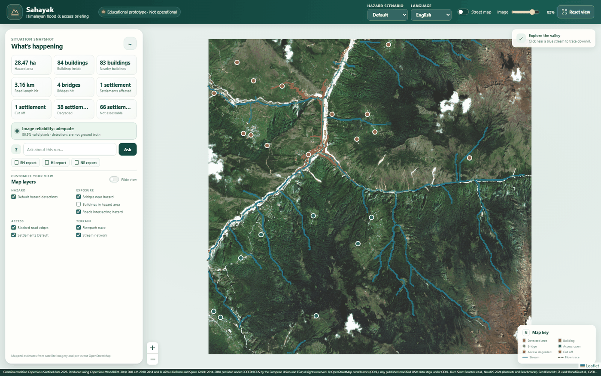
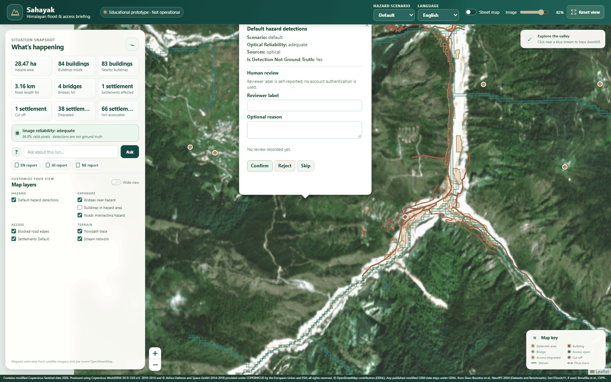
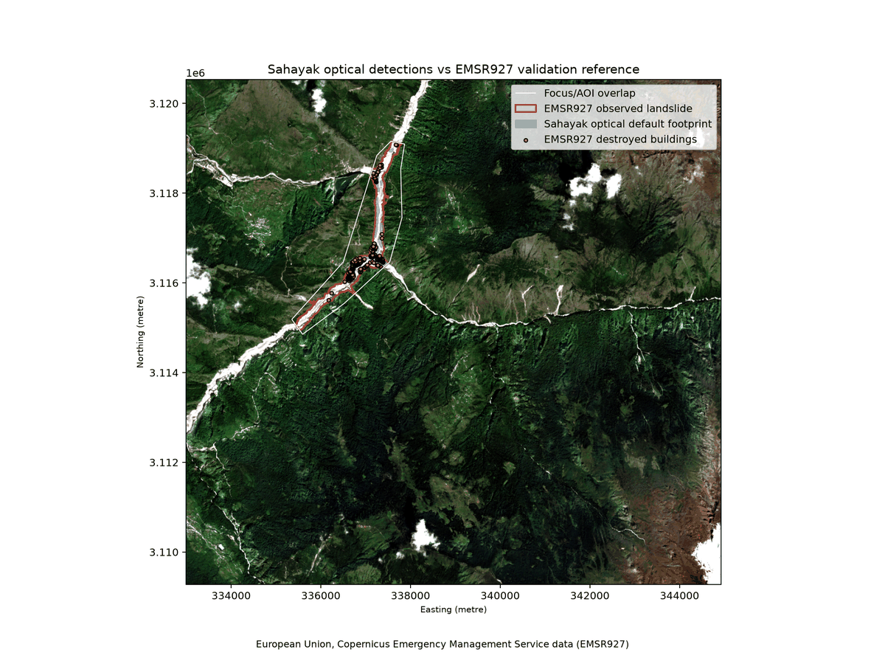
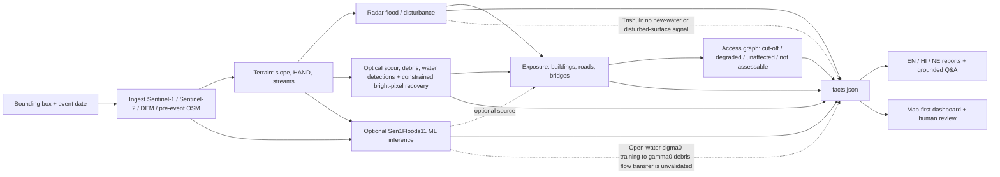
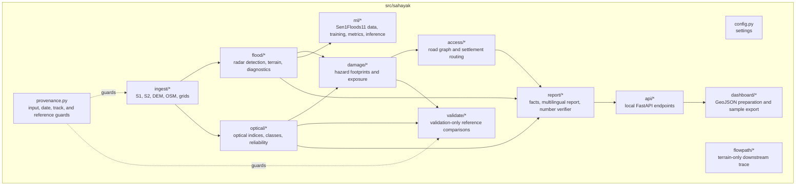

# Sahayak

**A satellite-to-briefing prototype for Himalayan flood and debris-flow response.**
Sahayak combines Sentinel-1 radar, Sentinel-2 optical imagery, Copernicus DEM
GLO-30, and strictly pre-event OpenStreetMap to produce mapped detections,
building and infrastructure exposure, road-access scenarios, and multilingual
briefings. In the Trishuli case study, the optical workflow mapped a 28.47 ha
default detection footprint and the access analysis consistently identified
Syapru Besi as cut off across all three hazard scenarios. The radar classifier
found no new-water or disturbed-surface signal for this debris-flow event; that
result is reported rather than altered to fit expectations.

**Educational prototype · Not operational.** Detection footprints and route
scenarios are not ground truth or field-confirmed instructions.

## Screenshots

| Map-first briefing | Human review controls | Validation comparison |
|---|---|---|
|  |  |  |

## Contents

- [Project workflow](#project-workflow)
- [Repository modules](#repository-modules)
- [Quick start: credential-free sample](#quick-start-credential-free-sample)
- [Full setup and environment](#full-setup-and-environment)
- [Run the pipeline](#run-the-pipeline)
- [Measured results](#measured-results)
- [Data, attribution, and licenses](#data-attribution-and-licenses)
- [Limitations & Future Work](#limitations--future-work)
- [AI-assistance disclosure](#ai-assistance-disclosure)
- [Technical design](docs/Technical_Design_Document.md)

## Project workflow



Radar and optical are separate evidence streams. In the Trishuli run the radar
signal was null for new water and disturbed surface, while the optical
detections supported exposure and access scenarios. The optional segmentation
model is an additional experiment, not a replacement for that finding.

## Repository modules



## Quick start: credential-free sample

The included derived sample has prepared map layers, headline facts, and
situation-report PDFs. It does not include raw scenes, DEM inputs, source
GeoPackages, or model weights. A local sample dashboard does not require
Copernicus or ohsome credentials:

```powershell
py -3.11 -m venv .venv
.\.venv\Scripts\Activate.ps1
python -m pip install -e ".[geo,api]"
sahayak serve --sample --run-id trishuli_syapru --port 8000
```

Open `http://127.0.0.1:8000/`. Sample mode is read-only: review persistence and
flowpath generation are disabled in that bundle. The local analytical layers
work offline; enabling the optional OpenStreetMap street-tile basemap requires
internet access.

## Full setup and environment

Use Python 3.11 on Windows PowerShell:

```powershell
py -3.11 -m venv .venv
.\.venv\Scripts\Activate.ps1
python -m pip install --upgrade pip
python -m pip install -e ".[dev,geo,api,ml]"
Copy-Item .env.example .env
sahayak doctor
```

Only the Sentinel-1 ingestion path requires Copernicus Data Space OAuth.
Default OSM ingestion uses the public Overpass provider and does not require a
key. An ohsome v2 key is optional. The current question-answering component is
deterministic and reads `headline.json`; the example LLM settings are reserved
configuration and do not activate an external language-model integration.
Never put credentials in source control or terminal output.

| Variable | Purpose | Credential source / default |
|---|---|---|
| `CDSE_CLIENT_ID` | OAuth client identifier for Copernicus Data Space | Create a free account and OAuth client in [Copernicus Data Space](https://dataspace.copernicus.eu/). Required for Sentinel-1 ingestion. |
| `CDSE_CLIENT_SECRET` | OAuth client secret | Copernicus Data Space OAuth client. Required for Sentinel-1 ingestion. |
| `CDSE_USERNAME` | Legacy account setting retained for compatibility | Not required by the current client-credentials token flow. |
| `CDSE_PASSWORD` | Legacy account setting retained for compatibility | Not required by the current client-credentials token flow. |
| `OSM_PROVIDER` | Select OSM provider | Defaults to `overpass`; or set to `ohsome`. |
| `OVERPASS_URL` | Overpass interpreter endpoint | Defaults to `https://overpass-api.de/api/interpreter`; public service has fair-use constraints. |
| `OHSOME_URL` | ohsome API base URL | Defaults to `https://api.ohsome.org/v1`. |
| `OHSOME_API_VERSION` | ohsome API version | Defaults to `v2`; the configured provider currently requires v2. |
| `OHSOME_API_KEY` | Authentication for ohsome v2 | Optional; request a key through [HeiGIT's ohsome account signup](https://account.heigit.org/signup). |
| `LLM_PROVIDER` | Reserved optional provider setting | No external LLM provider is currently wired into the deterministic copilot. |
| `LLM_API_KEY` | Reserved optional provider key | No external LLM call is currently made; do not configure a key expecting it to change answers. |
| `DATA_DIR` | Local input/cache root | Defaults to `data`. |
| `RUNS_DIR` | Local run-output root | Defaults to `runs`. |
| `SAHAYAK_ROOT` | Optional project-root override | Defaults to the discovered repository root. |

## Run the pipeline

Set `RUN_ID`, `EVENT_DATE`, and the four bbox coordinates to the event being
analyzed. The example below documents command order and outputs; it does not
substitute example coordinates for your area.

```powershell
$run = "RUN_ID"
$bbox = "MIN_LON,MIN_LAT,MAX_LON,MAX_LAT"
$networkBbox = "WIDE_MIN_LON,WIDE_MIN_LAT,WIDE_MAX_LON,WIDE_MAX_LAT"
$eventDate = "YYYY-MM-DD"

sahayak ingest --bbox $bbox --event-date $eventDate --run-id $run
sahayak ingest-network --run-id $run --bbox $networkBbox
sahayak flood --run-id $run
sahayak flood-diagnose --run-id $run
sahayak optical --run-id $run
sahayak damage --run-id $run --sources optical
sahayak access --run-id $run --sources optical
sahayak validate --run-id $run
sahayak ml-flood --run-id $run
sahayak facts --run-id $run
sahayak report --run-id $run --lang en,hi,ne
sahayak dashboard --run-id $run
sahayak serve --run-id $run --port 8000
```

Choose `networkBbox` wider than the focus bbox so roads and town/hospital
targets extend beyond the event area.

| Command | Main outputs |
|---|---|
| `ingest` | Run manifest and selection records; aligned Sentinel-1/Sentinel-2 scenes, DEM, and focus-area pre-event OSM. |
| `ingest-network` | Wide-area `network_osm_pre_event.gpkg` with roads, bridges, health facilities, and settlements. |
| `flood` | Terrain products, radar class/confidence rasters, polygons, and the radar section of `facts.json`. |
| `flood-diagnose` | `flood/diagnostics.json` with candidate funnels, validity diagnostics, and pre-event null-pair results. |
| `optical` | Optical class/confidence rasters, polygons, quicklooks, reliability, and optical facts. |
| `damage` | `hazard.gpkg`, `exposure.gpkg`, and scenario exposure facts. |
| `access` | `settlement_access.gpkg`, `blocked_edges.gpkg`, `access_map.png`, and scenario route facts. |
| `validate` | Validation-only `validation.json`, comparison figure, and summary; it does not tune thresholds. |
| `ml-flood` (optional) | `ml/` probability/class rasters, polygons, overlay, and the ML facts section. |
| `facts` | Curated `headline.json` sourced from the run's measured facts. |
| `report` | Verified EN/HI/NE report pages and PDFs when a local browser is available. |
| `dashboard` | Static dashboard bundle and simplified map layers under the run directory. |
| `serve` | Local dashboard/API service; it does not rerun the analysis stages. |

To include the optional ML mask in exposure/access, run inference first, then
rerun those analyses with `--sources optical,ml`; keep the optical-only
validation separate so its comparison remains reproducible. The optional
`flowpath` command traces terrain downhill from a supplied upstream point:

```powershell
sahayak flowpath --run-id RUN_ID --lon LONGITUDE --lat LATITUDE --distance-km 30
```

Every reported measurement is read from the generated run's `facts.json` or
curated `headline.json`; a language model is not used to invent figures.

## Measured results

### Sen1Floods11 held-out evaluation

The model threshold is the pooled validation-F1 threshold recorded in
[`metrics.json`](models/flood_unet_sen1floods11/metrics.json). All IoUs below
come from that file; Otsu and fixed `VV < -15 dB` baselines use the same
labelled split protocol recorded by the trainer.

| Split | Model IoU | VV Otsu IoU | Fixed VV < -15 dB IoU |
|---|---:|---:|---:|
| Validation | 0.6426 | 0.1857 | 0.4366 |
| Test | 0.6555 | 0.2074 | 0.4422 |
| Held-out Bolivia | 0.6655 | 0.3462 | 0.5785 |

The selected threshold is **0.526**. The validation split has 89 chips, test
has 90, and the separate held-out Bolivia split has 15. Baseline evaluation
skipped chips with too few valid labelled pixels; inspect the same metrics
artifact for the per-split skip counts. These dataset results do not establish
performance on the Trishuli event.

### Trishuli case study: optical and access findings

Values below are sourced from
[`facts.json`](runs/trishuli_syapru/facts.json),
[`headline.json`](runs/trishuli_syapru/headline.json), and the frozen
[`validation.json`](runs/trishuli_syapru/validate/validation.json).

| Measurement | Recorded result |
|---|---:|
| Optical default detection footprint | 28.47 ha |
| Mapped buildings intersecting default footprint | 84 |
| Mapped buildings within 30 m | 83 |
| Default road length intersecting detections | 3.1609 km |
| Default bridges within 20 m | 4 |
| Default affected settlements | 1 |
| Default cut-off settlements | 1 |
| Robust cut-off settlements (all three scenarios) | 1 |
| Settlements not assessable for access | 66 |

The cut-off settlement is **स्याप्रु बेसी (Syapru Besi)**. Its recorded blockers
are two unnamed primary-class road edges marked as bridges; they are the
identified graph blockers, not independently field-confirmed bridge failures.
The access result is a modelled road-network scenario, not an operational
closure report.

The radar classifier's recorded real-pair class areas are **0.0 ha new water**
and **0.0 ha disturbed surface** in the run facts. This is the documented
radar-null finding for this event.

### EMSR927 validation-only comparison

The validation artifact reports results **against the official EMS product
with a documented acquisition-date offset**. This is a validation comparison,
not an input to detection or threshold selection; EMSR927 is not perfect ground
truth.

| Comparison | Prediction / reference | Matched | Metric |
|---|---:|---:|---|
| Extent | 20.418 ha / 111.078 ha | — | IoU 0.1838; precision 0.9999; recall 0.1838; F1 0.3105 |
| Buildings, destroyed only | 84 / 323 | 81 | Precision 0.9643; recall 0.2508 |
| Buildings, all grades | 84 / 433 | 81 | Precision 0.9643; recall 0.1871 |
| Bridges | 4 / 5 | Not scored | Side-by-side counts only |
| Roads, hit length | 2.755 km / 7.634 km | Not scored | Side-by-side lengths only |

The EMSR927 post-event acquisition was **2026-08-27**; Sahayak's optical
post-event scene was **2026-10-01**, a recorded **35-day** difference.
Cut-off settlements and flowpaths are marked not comparable because the
reference product does not provide equivalent measurements. See
[`docs/validation.md`](docs/validation.md) and
[`validation.json`](runs/trishuli_syapru/validate/validation.json) for scope,
facility notes, and provenance.

## CI

[](https://github.com/srishtipandey1/sahayak/actions/workflows/ci.yml)

## Data, attribution, and licenses

### Required attribution

- Contains modified Copernicus Sentinel data 2026.
- Produced using Copernicus WorldDEM-30 © DLR e.V. 2010-2014 and © Airbus Defence and Space GmbH 2014-2018 provided under COPERNICUS by the European Union and ESA; all rights reserved.
- © OpenStreetMap contributors (ODbL). Any published modified OSM data stays under ODbL.
- Kuro Siwo: Bountos et al., NeurIPS 2024 (Datasets and Benchmarks). Sen1Floods11, if used: Bonafilia et al., CVPR Workshops 2020.
- Validation only: European Union, Copernicus Emergency Management Service data (EMSR927).

### Sources and licensing notes

Sentinel scenes are Copernicus free, full, and open data. The elevation source
is Copernicus DEM GLO-30. OSM is acquired from a snapshot strictly before the
event date and carries ODbL obligations for redistributed modified OSM data.
Sen1Floods11 is cited as Bonafilia et al., CVPR Workshops 2020; confirm
applicable upstream terms before redistributing derived model weights. Kuro
Siwo is not used in the current training run. EMSR927 is used only for
validation. See [`docs/data-rules.md`](docs/data-rules.md) and
[`LICENSE`](LICENSE).

## Limitations & Future Work

The Trishuli radar change detector found no event signal for new water or
disturbed surface; this is consistent with the distinction between an
open-water radar workflow and a debris-flow event. Extending labelled training
data to debris-flow events is a natural next step. The optional U-Net was
trained on Sen1Floods11 sigma0 open-water labels and applied to this
gamma0 terrain scene; the recorded Trishuli model output is not validated
event evidence.

Optical footprints are detections rather than ground truth, and cloud/snow
classification and image timing affect their interpretation. EMSR927 overlap
is constrained by the 35-day image-date difference, mapping scale, and
reference uncertainty. Access classes depend on pre-event OSM completeness,
fixed road speeds, snapping, and geometric blocking rules; field verification
is required before acting on them. Terrain products inherit the effective
resolution and assumptions of GLO-30. Sahayak is an educational prototype,
not an emergency service.

Next steps include debris-flow-specific labels, independent held-out Himalayan
case studies, calibrated uncertainty, and field checks for key access routes.
The detailed engineering limitations and methods are in
[`docs/Technical_Design_Document.md`](docs/Technical_Design_Document.md) and
[`docs/limitations.md`](docs/limitations.md).

## AI-assistance disclosure

I built Sahayak as a solo project and retained final responsibility for the
problem framing, technical direction, evidence evaluation, validation standards,
and interpretation of the results. AI assistants were used as implementation
and documentation partners to accelerate the build, but they did not define
the scientific method or sign off on the project’s conclusions.

The detailed disclosure and evidence trail are in
[`docs/ai-usage.md`](docs/ai-usage.md). All reported case-study, model, and
validation numbers are sourced from the repository’s run and evaluation files,
not invented by an assistant.
