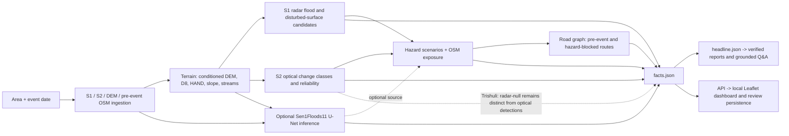
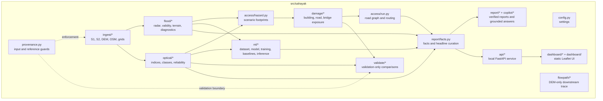
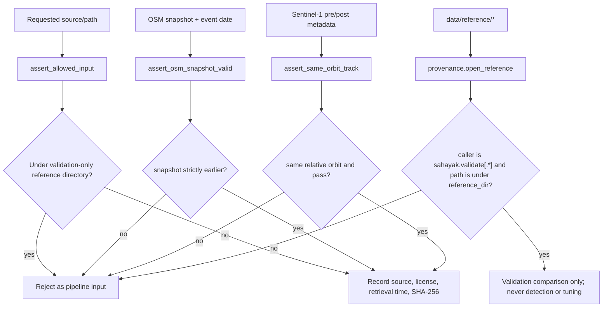
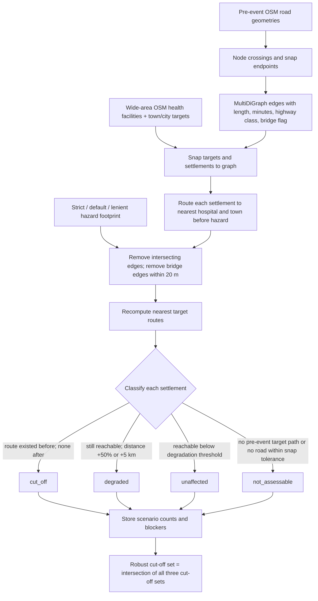

# Sahayak Technical Design Document

## Contents

- [Purpose and operating boundary](#purpose-and-operating-boundary)
- [Architecture overview](#architecture-overview)
- [Repository module map](#repository-module-map)
- [Provenance and rule enforcement](#provenance-and-rule-enforcement)
- [Methods by module](#methods-by-module)
- [Settlement access graph](#settlement-access-graph)
- [Validation protocol](#validation-protocol)
- [Limitations](#limitations)
- [Responsibility and data licensing](#responsibility-and-data-licensing)
- [Future work](#future-work)

## Purpose and operating boundary

Sahayak is an educational prototype that turns satellite scenes, terrain, and
pre-event OpenStreetMap into mapped hazard detections, infrastructure exposure,
and settlement-access scenarios. It is not an emergency service, hydraulic
model, field survey, or source of operational closure instructions. A footprint
is a detection, not ground truth. Reported numbers are sourced from generated
`facts.json` and curated `headline.json`; the copilot is constrained to those
facts.

The configured input boundary permits Sentinel-1, Sentinel-2, Copernicus DEM
GLO-30, strictly pre-event OpenStreetMap, and the Sen1Floods11/Kuro Siwo
training datasets. Published damage products, including Copernicus EMS and
UNOSAT, cannot be inputs or threshold-tuning references. The Trishuli EMSR927
product is accessed only through the validation package.

## Architecture overview

In the recorded Trishuli run, radar reported no new-water or disturbed-surface
area. Optical classifications are kept as a separate evidence source; their
presence does not turn the radar-null result into a radar detection. Optional
ML inference is also reported separately and is not calibrated for this
debris-flow scene.

## Repository module map

## Provenance and rule enforcement

`assert_allowed_input` rejects paths under the configured validation-only
reference directory. `assert_osm_snapshot_valid` enforces a strictly earlier
snapshot date. `assert_same_orbit_track` requires equal relative-orbit metadata and equal pass
direction; Sentinel-1 selection separately requires a valid positive relative
orbit before pairing. `open_reference`
checks both that the caller is under `sahayak.validate` and that the path is
within the configured reference directory. The run manifest records input
roles, sources, licenses, retrieval times, and SHA-256 values where files are
available. These are implementation guardrails; reviewers should still inspect
the run manifest and selection records for each analysis.

## Methods by module

### Input ingestion and alignment

The CLI accepts a geographic bounding box and event date. Sentinel-1
pre/post acquisitions are selected only when the relative orbit and pass
direction match. Sentinel-2 L2A scenes are screened with scene classification
and clear-pixel criteria documented in [`architecture.md`](architecture.md).
The selected rasters are warped onto a common projected grid. Copernicus DEM
GLO-30 is the terrain source. OSM features are requested from the selected
pre-event snapshot; network ingestion uses tiled requests, metadata timestamps,
and a per-element check against the snapshot date. Network layers retain
whitelisted attributes and are written in the run grid CRS.
See [`ingest/`](../src/sahayak/ingest/) and
[`provenance.py`](../src/sahayak/provenance.py).

### Terrain conditioning and HAND

The DEM is averaged onto the configured terrain working grid (30 m by default).
Pits are filled, depressions filled, and flats resolved before D8 flow direction
and accumulation are computed. Stream cells are selected when accumulation
exceeds the configured contributing-area threshold. PySheds computes
height-above-nearest-drainage (HAND) from the conditioned DEM and D8 drainage
network; in conceptual terms, for cell \(x\):

\[
\operatorname{HAND}(x) =
z(x) - z(d(x))
\]

where \(d(x)\) is the nearest downstream drainage cell assigned by the
flow-routing procedure. The computed terrain surface is resampled to the
analysis grid; this resampling does not increase the effective information
resolution beyond the source DEM. The raster band documents HAND in metres.
Negative HAND values are clipped to zero after quality-control statistics are
recorded. Implementation: [`terrain.py`](../src/sahayak/flood/terrain.py) and
[`flood.toml`](../configs/flood.toml).

### Sentinel-1 radar detection

The shared `radar_valid_mask` is built from data mask, shadow mask, local
incidence angle, physical VV/VH ceilings, and nodata/finite-value checks.
Positive shadow-mask pixels are excluded. Lee filtering is applied to linear
power, with local statistics computed from valid samples. For pixel value
\(I\), local mean \(\mu\), local variance \(\sigma^2\), and a global noise
estimate \(\sigma_n^2\) equal to the 20th percentile of valid local variances:

\[
g = \max\left(\frac{\sigma^2-\sigma_n^2}{\sigma^2},0\right),
\qquad
\hat I = \mu + g(I-\mu)
\]

The filtered power is converted to dB. The VV Otsu threshold is measured from
valid post-event pixels below the configured slope limit, then clamped to
`[-24, -14] dB` by `configs/flood.toml`. The detector compares the post scene
to the per-pixel multi-scene pre-event baseline for backscatter changes,
water candidates, and disturbed-surface candidates. Candidate cleanup,
minimum component area, HAND/slope limits, and confidence weights are config
controlled and copied into the facts provenance. Confidence is a heuristic,
not a calibrated probability. `flood-diagnose` evaluates a pre-event
null-pair placebo; placebo detections are false alarms by construction, not
ground truth. Implementation: [`preprocess.py`](../src/sahayak/flood/preprocess.py),
[`detect.py`](../src/sahayak/flood/detect.py), and
[`flood.toml`](../configs/flood.toml).

### Sentinel-2 optical detection

Reflectance is normalized between selected pre- and post-event scenes using
stable high-HAND, low-slope pixels after trimming change-distribution tails.
Pixels must pass SCL clear-class, data-mask, reflectance-range, and dilated
invalid-data checks. The normalized indices are:

\[
\operatorname{NDVI}=\frac{B08-B04}{B08+B04},
\qquad
\operatorname{MNDWI}=\frac{B03-B11}{B03+B11}
\]

The configured scour/debris class requires pre-event NDVI at least `0.30`,
post-event NDVI at most `0.15`, a change no greater than `-0.20`, a non-decrease
in visible brightness, and terrain eligibility. New water requires post-event
MNDWI at least `0.10`, pre-event MNDWI at most `-0.10`, and post-event NDVI
below `0.20`. Existing bare/channel conditions are separated from change
classes. The `bright_recovered` class is a constrained heuristic for bright
change near streams or damage detections in SCL cloud/shadow/snow classes; it
does not reconstruct obscured reflectance. The module evaluates pre-event and
post-event placebo pairs and records reliability, class areas, and
normalization. Implementation:
[`preprocess.py`](../src/sahayak/optical/preprocess.py),
[`detect.py`](../src/sahayak/optical/detect.py), and
[`optical.toml`](../configs/optical.toml).

### Hazard scenarios and exposure

Optical hazard levels are generated by dissolving class masks:

- **Strict:** scour/debris class only, with confidence at least `0.6`.
- **Default:** scour/debris, new water, and bright-recovered classes.
- **Lenient:** default footprint expanded by a `30 m` buffer.

The hazard facts carry optical reliability and explicitly identify the
footprints as detections, not ground truth. Optional extra sources are listed
explicitly and remain separable from the optical-only result.

For each scenario, mapped buildings are counted if they intersect the
footprint; nearby buildings are those within `30 m` without intersection.
Road impact is intersected length summarized by road class. Bridges within
`20 m` are counted as hit. A settlement is considered affected if its point is
within `100 m` of a footprint or it has a hit building within `300 m`. These
are geometric exposure rules; they do not establish structural damage or
habitability. Implementation: [`hazard.py`](../src/sahayak/access/hazard.py)
and [`damage/run.py`](../src/sahayak/damage/run.py).

### ML inference

The optional model is a U-Net trained and evaluated with Sen1Floods11
open-water labels. Inference uses the selected model checkpoint and validation
threshold recorded in `metrics.json`, with the same shared radar validity
rules and terrain constraints as configured for the flood stage. The model
output is an additional classification product, not trained evidence for
debris flows. The Trishuli application uses gamma0 terrain imagery while the
training distribution is sigma0 open-water scenes; the transfer shift and
pre-event placebo are recorded in `facts.json`. The threshold is not tuned on
the Trishuli output. Implementation: [`infer.py`](../src/sahayak/ml/infer.py);
recorded training and evaluation results:
[`metrics.json`](../models/flood_unet_sen1floods11/metrics.json).

### Reports, dashboard, and human review

The map products write `facts.json`, then `facts` curates source-linked values
into `headline.json`. Reports and the deterministic copilot use those curated
facts; numeric verification rejects output numbers not present in the
approved facts. English, Hindi, and Nepali report strings are generated, but
translations require native-speaker review. The dashboard serves local
GeoJSON, facts, imagery, and reports. Its review actions record a reviewer's
confirm/reject/skip decision and optional reason separately; review records do
not rewrite the detection or facts. Sample mode is read-only.

## Settlement access graph

The graph is a NetworkX `MultiDiGraph`; road lines are split at intersections,
with near endpoints clustered within the configured `3 m` tolerance. Roads
receive edge length and estimated minutes:

\[
\text{minutes}=\frac{\text{length}_{m}}{1000\cdot\text{speed}_{km/h}}\times60
\]

`configs/access.toml` provides assumed speeds by highway class, including
motorway/trunk `50`, primary `40`, secondary `30`, tertiary `25`,
unclassified `20`, residential `15`, track `8`, and path/steps `3 km/h`.
Settlements and targets may snap to a road up to `500 m`; this is an explicit
coverage assumption. After a baseline route is computed, every road edge
intersecting a hazard is removed from the scenario graph; a bridge edge is
also removed when it is within `20 m`. A cut-off means a baseline-reachable
settlement has no route afterward. Degraded means still reachable but route
distance grows by at least `50%` or `5 km`. Not-assessable remains a separate
class for missing baseline connectivity. Blocker names and bridge flags are
stored for the cut-off set. Travel times are deterministic estimates from
assumed speeds, not measured journey times. Implementation:
[`access/run.py`](../src/sahayak/access/run.py) and
[`access.toml`](../configs/access.toml).

## Validation protocol

The mapping pipeline is configured independently of the validation reference.
`validate` records the repository revision and hashes of the optical and access
configurations. A configuration change requires an explicit refreeze; a
comparison cannot silently retune thresholds. Null-pair placebos are computed
from pre-event scenes to expose false-alarm behavior. Model evaluation reports
validation, test, and held-out-region performance against Otsu and fixed
backscatter baselines.

EMSR927 is opened only through `sahayak.validate` and compared only in the
overlap of the event focus box and reference AOI. The reference product is
validation-only, is not perfect ground truth, and is not used to select
thresholds. Extent metrics include IoU, precision, recall, and F1; buildings
are compared under documented destroyed-only and all-grade definitions.
Bridge and road lengths are shown descriptively rather than treated as
matched-object scores. Cut-off settlements and flowpaths are marked not
comparable where the reference has no equivalent measurement. The Trishuli
comparison has a `35`-day acquisition-date offset; the results are specific to
that temporally mismatched overlap.

The current recorded evaluation values and frozen run evidence are in
[`runs/trishuli_syapru/validate/validation.json`](../runs/trishuli_syapru/validate/validation.json)
and
[`models/flood_unet_sen1floods11/metrics.json`](../models/flood_unet_sen1floods11/metrics.json).
The numerical comparison is also summarized in
[`validation.md`](validation.md). These artifacts provide reproducible
measurement provenance; they do not substitute for additional independent
case studies or field checks.

## Limitations

- Sentinel revisit and scene selection do not provide immediate post-event
  coverage in every event. Cloud, shadow, and snow constrain optical
  observations; Sentinel-1 has shadow and layover limitations in steep terrain.
- GLO-30-derived terrain processing uses a coarser working grid and does not
  recover terrain detail lost at the source resolution. HAND and slope are
  screening approximations, not flood hydraulics.
- Optical classes are spectral-change heuristics. The bright-recovery class is
  constrained but cannot infer reflectance beneath clouds.
- The Sen1Floods11 model is trained for sigma0 open-water flooding. Trishuli
  is gamma0 debris-flow terrain, so inference is an unvalidated transfer
  experiment, even when output is non-empty.
- OSM completeness, map date, snapping tolerance, fixed speed assumptions, and
  geometric hazard blocking affect exposure and route classes. Unmapped
  buildings and roads cannot be counted; route disruption is not field
  confirmed. No population is estimated.
- EMSR927 imagery dates differ from the selected Sentinel-2 scene, and the
  reference map has mapping-scale and interpretation uncertainty.
- Confidence/reliability values are not calibrated probabilities. Reports and
  translated text need human review before external use.

These are known development boundaries, not reasons to present modeled outputs
as confirmed conditions. See [`limitations.md`](limitations.md) for the
project's shorter user-facing limitation statement.

## Responsibility and data licensing

No victim imagery is included in the dashboard or sample screenshots. The
prototype banner is retained in the dashboard and the project must not be
presented as operational guidance. Human review annotations are optional,
reviewer supplied, and do not alter map facts.

Attribution strings are maintained in [`data-rules.md`](data-rules.md), the
README, dashboard footer, and generated report. Sentinel and Copernicus DEM
attribution is preserved; OSM-derived data is subject to ODbL requirements,
including share-alike obligations for published modified OSM data. Sen1Floods11
and Kuro Siwo are cited as training references; verify the upstream dataset
license before redistributing derived weights. EMSR927 is attributed as
validation-only. Project code licensing does not override source-data terms.

## Future work

1. Build a curated, licensed debris-flow training/evaluation set and evaluate
   on held-out Himalayan events, with the current open-water model retained as
   a transfer baseline.
2. Test complementary radar observations from a second orbit only through an
   explicitly evaluated fusion method; do not combine incompatible orbit/pass
   pairs as though they were a matched change pair.
3. Calibrate confidence against independent reference data and quantify
   spatial uncertainty rather than treating heuristic scores as probabilities.
4. Expand held-out case studies, compare against simple baselines, and record
   failures alongside successful detections.
5. Field-check high-impact route and bridge scenarios and improve OSM coverage
   assessment before using access outputs in any operational setting.
